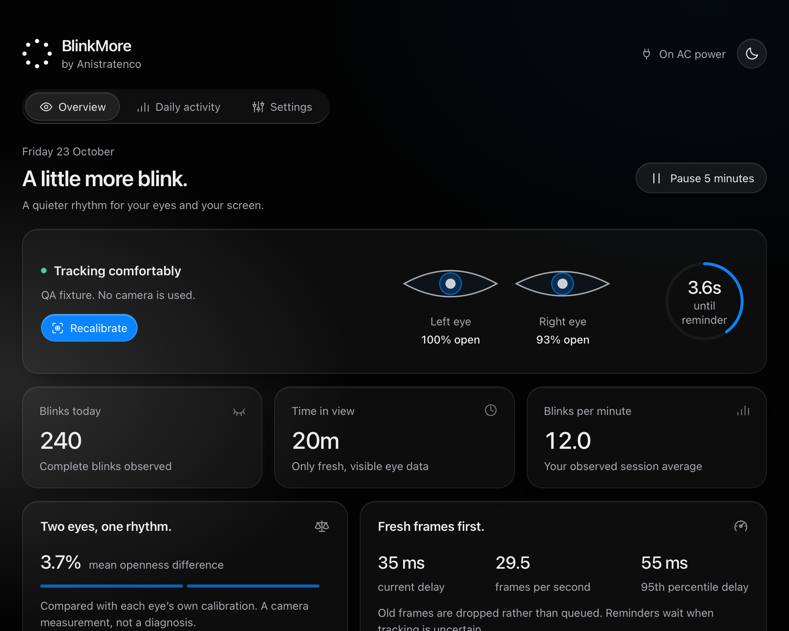
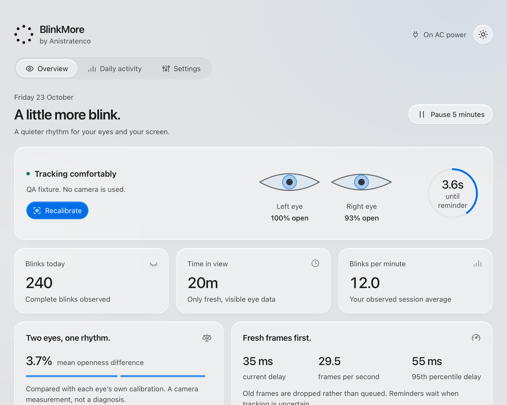

# BlinkMore

BlinkMore is a macOS menu bar app that gently fades the screen after a period without a detected blink. This fork keeps monitoring active on AC power and stops the app and camera on battery. It includes a calibrated Rust eyelid core, an Anistratenco dashboard, light and dark themes, daily activity and camera based eye balance measurements.

This is a fork of [oxremy/BlinkMore](https://github.com/oxremy/BlinkMore), maintained under [Solips1sm](https://github.com/Solips1sm/BlinkMore). The original MIT license and attribution are preserved. This build is separate from the upstream commercial app.





The screenshots use explicit QA fixtures. They contain no real camera images or personal tracking data.

## Build and install

Use macOS 14 or later, Xcode Command Line Tools and the stable Rust toolchain. Node.js is used only for the JavaScript syntax check. Build on the Mac architecture you intend to run.

```sh
Scripts/test.sh
Scripts/build.sh
Scripts/install.sh
```

Set `BLINKMORE_SIGN_IDENTITY` when a valid local code signing identity is available; otherwise the build uses an ad hoc signature.

The build produces `dist/BlinkMore.app` and `dist/BlinkMoreACAgent`. The installer backs up the current app before replacing `/Applications/BlinkMore.app`, installs one login LaunchAgent and migrates the earlier Codex power watcher. It restores the previous app if installation fails. Installation requires write access to `/Applications`; it does not request administrator privileges automatically.

Allow camera access when macOS requests it. A locally signed replacement can require camera approval again. Look toward the camera with your eyes naturally open and blink normally while calibration completes. Open the eight circle menu icon to reach the dashboard. The screen reminder duration and color from the previous installation are retained. Sensitivity uses the new calibrated scale.

Monitoring starts automatically when the charger is connected, including after login and wake. Disconnecting AC stops the app and releases the camera. Pause turns off the camera for five minutes; Resume starts a new calibration immediately. Turning off screen reminders keeps local activity measurement running. Preview applies a two second fade without changing the daily reminder count.

## Tracking and performance

AVFoundation captures 640 × 480 frames and discards late frames. Vision detects a single face, follows its bounding box between full searches and finds both eyelid contours. The inference queue is serial and separate from the UI. There is at most one pending UI delivery, so a busy dashboard cannot create an unbounded frame backlog. Full face searches run every 0.7 seconds; a second person entering between searches can take that interval to be detected.

Rust handles contour geometry, pixel aspect correction, independent eye calibration, smoothing, hysteresis, bilateral blink episodes and time accounting. It uses no external crates and allocates no memory during frame processing. Calibration collects at least 18 valid observations and 1.2 seconds of visible data. It derives each eye’s baseline from its upper aperture percentile. The C interface is used only from the capture queue; borrowed landmark buffers stay alive through each call.

Frames older than 250 ms are rejected. Gaps over 250 ms reset blink episodes and the reminder clock, so missed camera time cannot become a phantom blink or an immediate fade. Face loss, uncertain pose and multiple faces clear reminders. Camera errors and a stalled stream trigger bounded retries. Closing the dashboard releases its WebKit view and update timer. Screen overlays redraw only when their color or intensity changes, and animate only on visibility transitions.

The Rust benchmark processes one million synthetic updates. The recorded Intel run measured a 714 ns 95th percentile per update, or 817 ns with two additional busy CPU workers. See [the measurement](docs/core-benchmark.json). These values exclude camera capture, Vision and display latency. They establish core overhead, not a measured improvement in real world detection accuracy or a guarantee under arbitrary CPU saturation. The dashboard shows actual camera delay, recent 95th percentile delay and processed frame rate. Eyeglass reflections, lighting, camera angle and CPU contention still affect tracking.

## Daily activity and privacy

Camera frames and facial landmarks stay in memory. The app has no network entitlement and the local dashboard blocks network requests. It saves daily blink counts, visible tracking time, separate unilateral closure counts, reminder counts and aggregate calibrated openness differences. Files are stored in the app sandbox under `Library/Application Support/BlinkMore/daily-statistics.json`. No raw eye measurements, video or per blink timestamps are written during normal operation. The explicit `--diagnose` launch flag writes one local status file with the current processing phase, calibration progress, quality checks and timing for troubleshooting. It contains no camera images or eye contour coordinates.

The eye difference compares current openness against each eye’s own calibrated baseline. It describes unequal movement during tracked open eye periods, rather than anatomical eye size or a medical diagnosis. Separate unilateral closure counters describe short closures without a matching closure in the other eye. Blink rate appears after 30 seconds of visible data; mean eye difference appears after five seconds of calibrated open eye data.

The Daily activity view shows seven days. JSON export includes retained history. Delete daily statistics requires confirmation and preserves data if the file cannot be removed safely. Saves are atomic and run off the capture queue. Corrupt files are copied for recovery before replacement; failed recovery disables saving to avoid overwriting the original. Recovery copies remain available locally after deleting current statistics.

## Interface

The dashboard adapts the semantic foundations, glass surfaces, radii, accent roles, motion and eight circle mark from `Anistratenco/anistratenco-ui` to a local WebKit surface. It does not modify that separate repository. AppKit owns the camera lifecycle, menu bar, screen overlay, permissions and file dialogs. The UI bridge accepts commands only from the bundled main page and validates setting types and bounds in native code. The camera is never exposed to page JavaScript.

The dashboard includes calibration, visible tracking, eye closure, no face, multiple faces, poor pose, stale frames, pause, denied permission, missing camera and capture error states. Appearance follows the system or an explicit light or dark setting. Controls support keyboard focus, accessible labels, tab navigation and reduced motion. Visible text uses a 14 px minimum.

## Validation

`Scripts/test.sh` runs ten Rust tests, Clippy with warnings rejected, JavaScript syntax validation and native preference and persistence tests plus a real Swift to Rust ABI test on macOS. Coverage includes unordered contours, head roll, face aspect, independent eye sizes, blinks at 15 to 60 fps, unilateral closures, long closures, missing frames, stale time, FFI boundary validation, recovery, deletion ordering and daylight saving rollover.

Run the actual WebKit dashboard checks in a logged in macOS GUI session:

```sh
swiftc -parse-as-library Tests/DashboardTests.swift BlinkMore/Core/TrackingState.swift BlinkMore/UI/DashboardWindowController.swift -o test-results/dashboard-tests
test-results/dashboard-tests
```

These checks exercise every tracking state, both themes, rendered SVG icons, native control messages, keyboard tabs, the smallest window size and minimum text size. Screenshots are written to `test-results`. CI tests the Rust core on Linux and builds the native app on macOS. Camera accuracy, battery transitions and screen visibility require a real Mac and are not claimed by synthetic tests.
